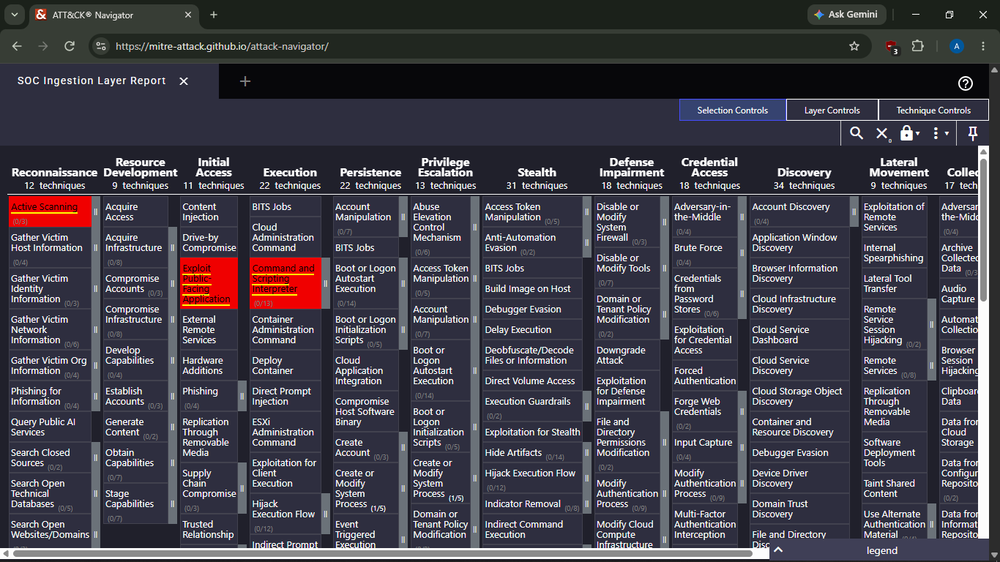
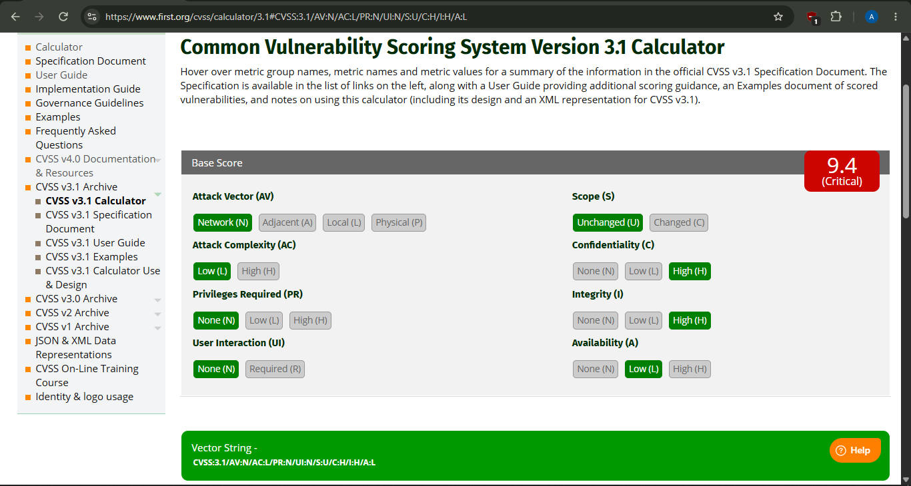

# The Unified SOC Automation & Detection Engine

A self-built, end-to-end SOC pipeline: detection logic in Splunk, automated enrichment and case creation via Python, threat intelligence correlation through VirusTotal, incident tracking in TheHive, MITRE ATT&CK mapping, CVSS scoring, and hands-on forensic validation using a self-hosted vulnerable web app.

Built as a first-year cybersecurity portfolio project to demonstrate practical SOC analyst and automation skills — not just following a tutorial, but building, breaking, debugging, and documenting a real working system.

---

## Overview

This project simulates a functioning SOC detection-to-response workflow:

1. **Splunk** detects suspicious activity (reconnaissance, SQL injection, persistence, execution) using custom SPL queries, mapped to vendor-neutral Sigma rules.
2. A **Python automation pipeline** queries Splunk's REST API, polls for job completion, extracts results, enriches the source IP via the **VirusTotal API**, and creates a fully populated alert in **TheHive**.
3. The pipeline runs **unattended**, triggered on a schedule via Windows Task Scheduler.
4. Detected techniques are automatically mapped to the **MITRE ATT&CK Navigator** via a reusable layer-generation script.
5. A separate validation exercise — attacking a self-hosted **DVWA** instance — was used to capture real forensic evidence (Wireshark, CyberChef) and demonstrate exploitation technique end-to-end.
6. Findings were scored using **CVSS v3.1** and written up in a full incident report.

---

## Architecture

```
Splunk (SPL detection)
      │
      ▼
Python pipeline (fetch → poll → enrich)
      │
      ├──► VirusTotal API (IP reputation enrichment)
      │
      ▼
TheHive (alert creation, case management)
      │
      ▼
MITRE ATT&CK Navigator (technique mapping, via threat_syncer.py)
```


Scheduled automatically via Windows Task Scheduler — no manual intervention required once configured. See [`evidence/task_scheduler_automation.png`](evidence/task_scheduler_automation.png) for proof of a successful unattended run.

---

## Tech Stack

- **SIEM:** Splunk Enterprise (Free)
- **Case Management:** TheHive
- **Threat Intelligence:** VirusTotal API
- **Automation:** Python 3 (`requests`, `time`, `logging`)
- **Scheduling:** Windows Task Scheduler
- **Forensics:** Wireshark, CyberChef
- **Vulnerable Target (lab validation):** DVWA
- **Framework Mapping:** MITRE ATT&CK Navigator
- **Scoring:** FIRST CVSS v3.1 Calculator

---

## Detections

| # | Name | SPL Query | MITRE Technique |
|---|---|---|---|
| 1 | Reconnaissance — Port Scan | [`/detections/recon_spl_query.yml`](detections/recon_spl_query.yml) | T1595 — Active Scanning |
| 2 | Initial Access — SQL Injection / Web Exploitation | [`/detections/sqli_web_exploitation.yml`](detections/sqli_web_exploitation.yml) | T1190 — Exploit Public-Facing Application |
| 3 | Persistence — Windows Service Creation | [`/detections/windows_service_persistence.yml`](detections/windows_service_persistence.yml) | T1543.003 — Windows Service |
| 4 | Execution — Web Shell / Encoded Command | [`/detections/webshell_execution.yml`](detections/webshell_execution.yml) | T1059 — Command and Scripting Interpreter |

Each detection is written as a Splunk SPL query and translated into a vendor-neutral Sigma rule, so the logic isn't locked to one SIEM platform.

---

## Automation Pipeline

The core script (`automation/test_hive_connection.py`) handles the full flow:

1. Authenticates to Splunk and submits the detection search
2. Polls the search job's status endpoint until the job completes (avoids the async race condition where results are queried before Splunk finishes processing)
3. Pulls the results and loops through each flagged event
4. Enriches the source IP via VirusTotal (`automation/email_security_and_threat_intelligence_enrichment.py`)
5. Builds and posts a structured alert into TheHive via its REST API — see [`evidence/thehive_alert.png`](evidence/thehive_alert.png) for a live example
6. Generates a MITRE ATT&CK Navigator layer file from the confirmed techniques (`automation/threat_syncer.py`)

### Scheduling

Runs automatically via Windows Task Scheduler on a recurring interval — fully unattended. Credentials (Splunk, TheHive, VirusTotal) are stored as permanent environment variables rather than hardcoded, so the scheduled task can authenticate without a terminal session. Proof of a successful unattended run: [`evidence/task_scheduler_automation.png`](evidence/task_scheduler_automation.png).

### Error Handling

The pipeline includes defensive handling for real-world API unreliability — failed enrichment calls, malformed responses, and authentication issues are caught and logged (to file, for visibility during unattended runs) rather than crashing the script or silently corrupting alert data.

### Known Limitations

An MXToolbox blacklist-check integration was built and tested successfully, but removed from the live pipeline — the free tier's request quota proved too unreliable for continuous automation. The code remains in the enrichment module as a reference implementation.

---

## Forensic Analysis

Since raw packet captures aren't publicly distributed for the BOTSv1 dataset used in detection development, forensic validation was performed against a self-hosted, deliberately vulnerable target instead — giving full control over the attack, the evidence, and the explanation of both.

**Setup:** DVWA deployed in an isolated VirtualBox lab network, attacked from a Kali Linux VM on the same host-only subnet.

**Attack performed:** SQL injection against DVWA's `id` parameter (`/vulnerabilities/sqli/`), payload `' OR '1'='1`.

**Evidence captured:**
- [`evidence/http_stream.png`](evidence/http_stream.png) — Full HTTP request/response reconstructed in Wireshark
- [`evidence/cyberchef_decode.png`](evidence/cyberchef_decode.png) — URL-encoded payload decoded in CyberChef
- [`evidence/dvwa_response.png`](evidence/dvwa_response.png) — Application response confirming full user-table exposure
- [`evidence/wireshark_filter.png`](evidence/wireshark_filter.png) — Filtered capture showing the relevant HTTP traffic

Full write-up, screenshots, and reasoning in [`incident_report.md`](incident_report.md).

---

## MITRE ATT&CK Mapping

All four detection techniques were mapped and auto-generated into a Navigator-compatible layer file using `threat_syncer.py` — a script originally built for a prior project and adapted here.



---

## CVSS v3.1 Severity Scoring

**Score:** 9.4 (Critical)
**Vector:** `CVSS:3.1/AV:N/AC:L/PR:N/UI:N/S:U/C:H/I:H/A:L`



Full metric-by-metric justification in [`incident_report.md`](incident_report.md).

---

## Incident Report

Full write-up — timeline, technical breakdown, impact assessment, CVSS scoring, and remediation recommendations — available in [`incident_report.md`](incident_report.md).

---

## Lessons Learned

This project involved a lot of first-time problem-solving, not just following a checklist. A few things worth calling out:

- **Configuring TheHive from scratch** — getting the platform running, understanding its permission model (and learning the hard way that the platform `admin` role isn't the same as an org-level analyst role with case/alert permissions), and working through its API schema through trial and error rather than copy-pasting examples.
- **Working with Python's `time` library for the first time** — specifically using `time.sleep()` to solve a real async race condition, where the script was trying to pull search results from Splunk before the job had actually finished processing. Understanding *why* polling was necessary (not just that it was) was a genuinely useful concept to internalize.
- **Reusing code across projects** — integrating `threat_syncer.py`, a MITRE ATT&CK layer-generation function originally built for a separate, earlier project, into this pipeline. Rather than rebuilding that logic from scratch, I adapted the existing functions (parameterizing them, wiring them into a new context) — a small but real lesson in writing reusable code instead of one-off scripts.
- **Debugging environment variables across different terminal sessions** — repeatedly losing API keys and passwords because `$env:` variables set in one PowerShell tab didn't carry over to another, or didn't persist across days. This eventually led to properly setting permanent system environment variables instead, which also mattered for getting Windows Task Scheduler to run the pipeline unattended.
- **Handling unreliable third-party APIs gracefully** — MXToolbox's free-tier rate limit kept blocking testing throughout the week. Rather than letting one failed API call crash the whole script, I added defensive checks (`isinstance()` validation, `None` handling) so a single enrichment failure wouldn't silently corrupt or crash the rest of the pipeline.
- **Pragmatic scoping under real constraints** — BOTSv1's raw PCAP files weren't publicly available the way I expected. Rather than forcing a workaround or faking it, I built a small, self-contained DVWA lab to generate and capture real, legitimate attack traffic myself — which ended up producing stronger, more explainable evidence than borrowed historical data would have.

---

## Repository Structure

```
├── detections/
├── automation/
├── evidence/
├── incident_report.md
└── README.md
```
---

## Setup

1. Splunk Enterprise (Free) with the BOTSv1 dataset indexed
2. TheHive instance (Docker/VM)
3. VirusTotal API key
4. Python 3 with `requests` installed
5. Set the following as permanent environment variables: `splunkpass`, `thehivekey`, `vtkey`
6. Run `automation/test_hive_connection.py`, or schedule it via Task Scheduler for automated runs

---

## Author

Kamogelo Albert Moremi — [LinkedIn](https://www.linkedin.com/in/albert-moremi-a0ba7834a/) — [GitHub](https://github.com/Kamo-cyber)