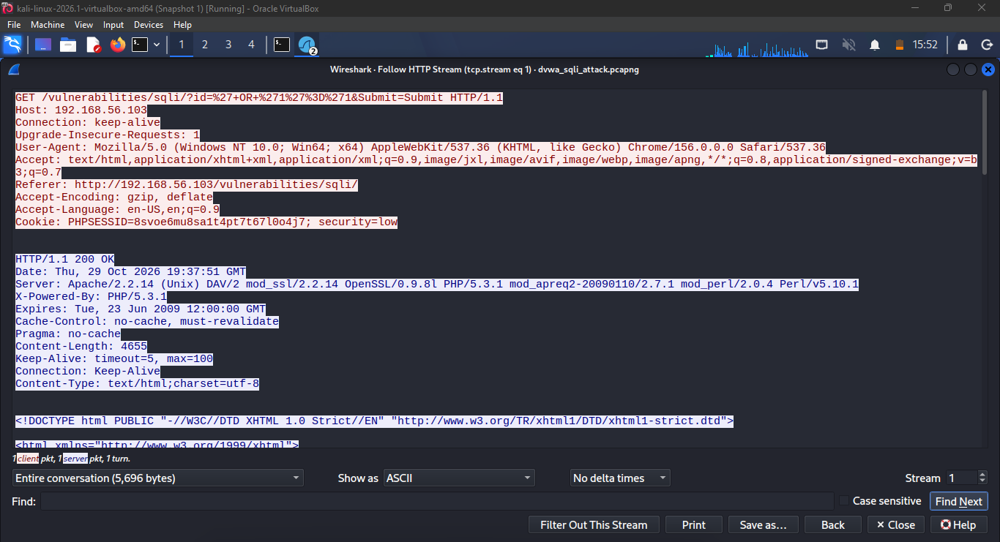
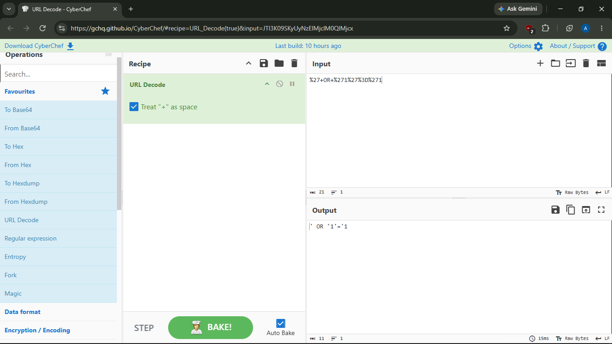
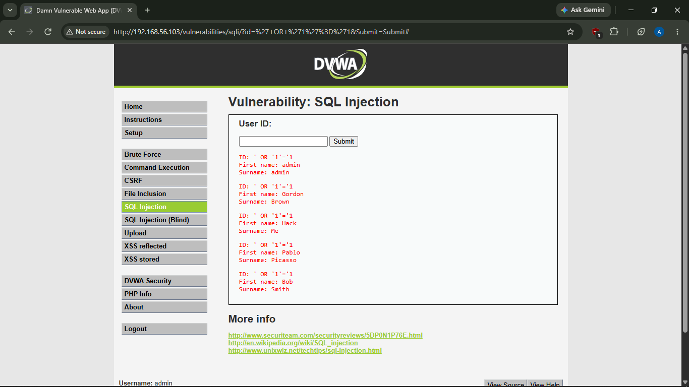
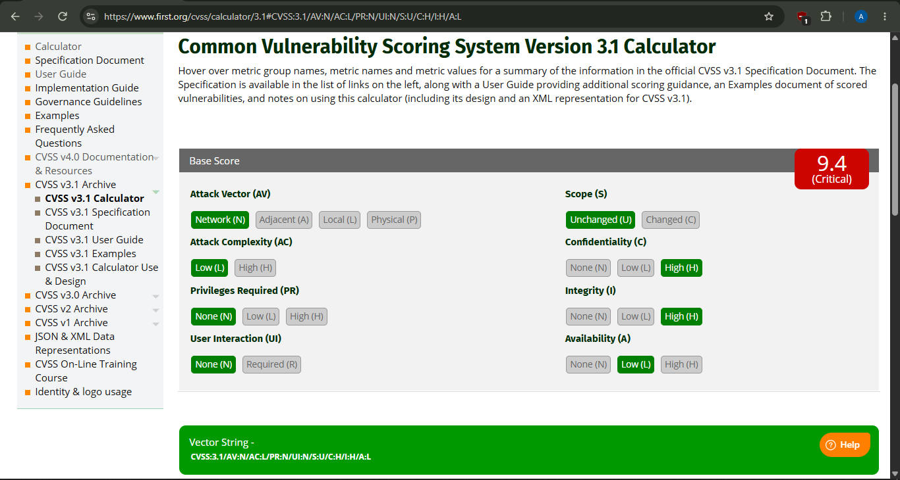

## Incident Report

### Summary
The incident was initially identified through advanced Splunk filtering with the objective to identify active reconnaissance. Indicators of compromise included high volume requests to multiple distinct ports. Several tools were utilized including scripting to automate the process of retrieving the query and specific log, parsing it into python objects, bridging to VirusTotal, and ultimately triggering an alert in TheHive for further investigation and triage.

---

### Timeline

| Time (UTC) | Event |
|---|---|
| recon timestamp, ~13:54 Oct 24 | Reconnaissance detected — port scan activity from src_ip 192.168.2.50 against internal hosts, flagged by Splunk detection #1 |
| 22:31, Oct 28 | Automated pipeline triggered: Splunk alert fired, enriched via VirusTotal, ingested into TheHive as alert #12296 |
| [threat intelligence (Mitre Att&ck Navigator) timestamp, ~ 22:10 Oct 29] | After the VirusTotal threat investigation. Mitre Att&ck Navigator had been utalized to further investigate, accurately understand and make a professional and evidence based judement on how servere and sophisticated the attack may be. |
| Thu, 29 Oct 2026 19:37:51 GMT | SQL Injection confirmed — payload `' OR '1'='1` submitted to `/vulnerabilities/sqli/` endpoint on 192.168.56.103, captured via Wireshark |
| same timestamp or shortly after | Server returned full contents of users table (5 records) instead of single requested record — confirms successful exploitation |
| decoding timestamp, ~22:05 Oct 29 | To decode the specific wireshark logged traffic, CyberChef was used to decode the specific string within the url/traffic using the URL Decode feature, which decoded the URL into `' OR '1'='1`. This  further confirmed a critical indicator of compromise.

---

### Technical Details

**Vulnerable Component:** [endpoint, parameter — `id` on `/vulnerabilities/sqli/`]

**Attack Vector:** [how the attacker reached it — describe] The attacker identified the web login page to have insecure input validation and improper sanitization. Because of this, they used the well known vector for exploiting this form of vulnerability which is the `' OR '1'='1` . Since the statement "1 equals 1" is always true, adding it to a database search command forces the system to say "yes" and grant access, even if the password or username is wrong.

**Payload Used:**

URL-encoded form as observed in the raw request: `%27+OR+%271%27%3D%271` (' OR '1'='1)

**Evidence:**
-  — Full HTTP request/response reconstructed in Wireshark, showing the injected payload and the server's response containing all user records.
-  — URL-encoded payload decoded to reveal the raw injection syntax
-  — Browser-rendered view confirming the application returned data for all users instead of the single requested record

---

### Impact

This is a critical vulnerability. A single unauthenticated request exposed the entire user table — no login, no privileges, no user interaction needed.

- **Confidentiality:** Fully compromised — all user records exposed in one request. In production, this kind of flaw routinely leaks PII or credentials.
- **Integrity:** Also at risk — the same technique could be adapted to modify or delete data, not just read it.
- **Availability:** Limited impact here, since this exercise focused on data exposure rather than destructive queries. Matches the Low rating in the CVSS score below.

---

### MITRE ATT&CK Mapping

| Phase | Technique | ID |
|---|---|---|
| Reconnaissance | Active Scanning | T1595 |
| Initial Access | Exploit Public-Facing Application | T1190 |
| Persistence | Windows Service | T1543.003 |
| Execution | Command and Scripting Interpreter | T1059 |

---

## CVSS v3.1 Severity Scoring

**Scenario scored:** The score is in correlation to the identified Splunk(SIEM) based on suspicious network traffic indicating signals of an SQL Injection Attack.

**Vector String:** `CVSS:3.1/AV:N/AC:L/PR:N/UI:N/S:U/C:H/I:H/A:L`

**Base Score:** 9.4 (Critical)

### Metric Breakdown

**Attack Vector (AV): Network**
Threat actors or even cyber criminals can exploit lack of proper input sanitization remotely as the improper configured web forms are publicly accessible over the internet. Classifying this as an outward facing entry point.

**Attack Complexity (AC): Low**
SQL Injection involves the exploitation of improper sanitization or input fields, thus not requiring high level sophistication to execute.

**Privileges Required (PR): None**
The attacker does not require prior access as the attacker can obtain certain unauthorized privileges as a result of successful execution. Some of the privileges the attacker can inherit are the ability to delete data, perform administrative bypass and access highly sensitive/confidential databases.

**User Interaction (UI): None**
Unlike phishing or any form of user dependent attacks, SQL Injection is executed entirely by the attacker remotely by identifying and exploiting existing sanitization flaws.

**Scope (S): Unchanged**
In this instance, through analytic judgement, it is accurate to determine that the attacker did not obtain further access to outside systems beyond the web application and its connected database. There is no evidence in this scenario of the attacker breaking out of that boundary into a separate system or the underlying host OS. 

**Confidentiality (C): High**
SQL Injection attacker highly compromises the Confidentiality pillar of the CIA Triad. This is due to the fact that an attacker can gain access to sensitive PII, PHI or strategic plans.

**Integrity (I): High**
The Attack Vector (SQL Injection) enables the attacker to not only access sensitive database data but also allow unauthorized users to manipulate, corrupt, or destroy information stored within a database

**Availability (A): Low**
 SQL injection (SQLi) often prioritizes confidentiality (stealing data) and integrity (modifying or deleting records) over total system crashes.

### Calculator Screenshot

---

### Remediation Recommendations

- Parameterized Queries: Use prepared statements so the database treats user input strictly as data, never as executable code.
-  Deploy WAF rules to detect and block common SQL injection patterns (OR 1=1, UNION SELECT, etc.)
-  Enforce input validation/sanitization at the application layer
- Apply least-privilege database account permissions so a compromised web app account can't read/modify unrelated tables

---

### Status

Alert generated automatically via the detection pipeline (TheHive alert ##12296). Manual validation confirmed a critical SQL injection vulnerability through controlled exploitation. Remediation steps above. **Closed as confirmed true positive.**
